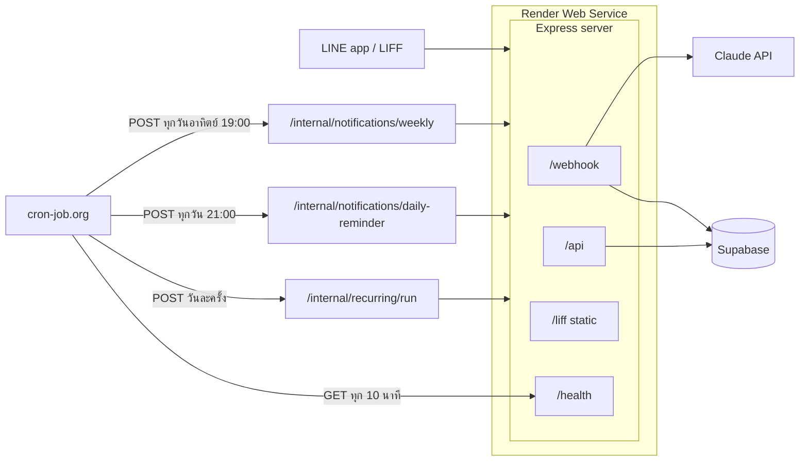

# line-expense-bot

LINE Official Account ที่บันทึกรายรับรายจ่ายจากข้อความภาษาธรรมชาติ (เช่น "กินข้าว 60 กาแฟ 45") โดยใช้ Claude แยกข้อความเป็นรายการ เก็บลง Supabase และมีเว็บ LIFF เปิดในแอป LINE สำหรับดู แก้ไข และวิเคราะห์ข้อมูล รองรับหลายผู้ใช้

## ความสามารถ

- **บันทึกด้วยข้อความ:** พิมพ์ภาษาธรรมชาติ ถ้ากำกวมบอทถามกลับสั้นๆ ก่อนบันทึก บอทตอบเป็นการ์ด (Flex Message) สรุปรายการที่บันทึก พร้อมปุ่ม "ยกเลิก" ท้ายการ์ด
- **แตะรายการในการ์ด:** เปิดหน้าเว็บที่ตัวแก้ไขของรายการนั้นทันที (ลิงก์ `?tx=<id>&d=<วันที่>`)
- **อ่านสลิป/ใบเสร็จ:** ส่งรูปให้บอทอ่านยอดรวมที่จ่ายจริง (ยอดสุทธิหลังส่วนลดของใบเสร็จ หรือยอดโอนของสลิป) เป็นรายการเดียว ไม่แยกสินค้า รายจ่ายลงหมวด "ใบเสร็จ/สลิปโอนเงิน" ส่วนสลิปที่ผู้ใช้เป็นฝ่ายรับเงินลงรายรับหมวด "อื่นๆ" โน้ตเป็นชื่อร้านหรือชื่อผู้รับ/ผู้โอน บอทตอบการ์ดพร้อมปุ่ม "บันทึก/ยกเลิก" และบันทึกจริงเมื่อกดยืนยัน ก่อนส่งให้ Claude บอทหมุนรูปตาม EXIF ย่อด้านยาวไม่เกิน 1568px และปรับความสว่าง/คอนทราสต์ ถ้าปรับรูปไม่สำเร็จจะใช้รูปเดิม
- **สรุปวัน/สัปดาห์/เดือน:** พิมพ์ `สรุปวันนี้` `สรุปสัปดาห์นี้` `สรุปเดือนนี้` (หรือ `สรุป` เพื่อเลือกช่วง) คำนวณยอดด้วย SQL แล้วส่งเป็นการ์ด
- **ถามยอด:** พิมพ์ถาม เช่น `เดือนนี้กินกาแฟไปเท่าไหร่` หรือ `ค่าเดินทางเดือนที่แล้วเท่าไร` Claude แปลงคำถามเป็นช่วงวัน ประเภท หมวด และคำค้นในโน้ต แล้ว SQL รวมยอด บอทตอบยอดรวมและจำนวนรายการเป็นการ์ด Flex พร้อมปุ่ม `ดูรายการในเว็บ` ที่เปิดแท็บรายการของเดือนนั้นในหน้า LIFF โดยกรอกคำค้น (หรือชื่อหมวด) และประเภทให้ (ช่วงไม่เกิน 366 วัน ถ้าไม่บอกช่วงใช้เดือนนี้)
- **งบประมาณและการเตือน:** ตั้งงบต่อหมวด เตือนทุกครั้งที่บันทึกรายจ่ายแล้วยอดถึง 80% ของงบ (ใกล้เต็มงบ) หรือเกินงบ แสดงเป็นแถบสีในการ์ด
- **รายการประจำ:** บันทึกอัตโนมัติตามรอบเดือน จัดการผ่านหน้า LIFF และแจ้งใน LINE พร้อมปุ่มยกเลิก
- **สรุปรายสัปดาห์:** เปิดสวิตช์ `ส่งสรุปทุกวันอาทิตย์` ในแท็บโปรไฟล์ (ค่าตั้งต้นปิด) แล้วทุกวันอาทิตย์ 19:00 บอท push การ์ดสรุปสัปดาห์นั้น (จันทร์-อาทิตย์) แบบเดียวกับ `สรุปสัปดาห์นี้` แต่ไม่มีคอมเมนต์จาก Claude สัปดาห์ที่ไม่มีรายการไม่ส่ง และไม่ส่งเกินสัปดาห์ละครั้งต่อคน ถ้าผู้ใช้ block บอท (unfollow) สวิตช์แจ้งเตือนทุกตัวของคนนั้นถูกปิด กลับมาเพิ่มเพื่อนแล้วต้องเปิดเองในแท็บโปรไฟล์
- **เตือนลืมจด:** เปิดสวิตช์ `เตือนถ้าวันนี้ยังไม่ได้จด` ในแท็บโปรไฟล์ (ค่าตั้งต้นปิด) แล้วถ้าถึง 21:00 วันนั้นยังไม่มีรายการที่พิมพ์ ส่งสลิป หรือสร้าง/ยืนยันบิลเอง (ตามเวลาที่บันทึก เวลาไทย รายการประจำไม่นับ) บอท push ข้อความเตือนสั้นๆ วันละไม่เกินครั้ง
- **เว็บ LIFF 5 แท็บ (ธีมสว่างอย่างเดียว หน้าตาเข้าชุดกับ Rich Menu: หัวน้ำเงินมีมาสคอตเฮียสมัคร ปุ่มหลักสีเหลือง แถบแท็บล่างสีขาว):**
  - รายการ: ยอดคงเหลือเดือนนี้ ค้นหา/กรอง แก้ไข และลบ (แตะแถวเพื่อแก้ไข ปัดแถวไปทางซ้ายเพื่อเผยปุ่มลบ)
  - สรุป: กราฟตามหมวด แนวโน้ม 6 เดือน เทียบกับเดือนก่อน และ Export CSV
  - จัดการงบ: ตั้งงบต่อหมวดต่อเดือน และปุ่ม "เพิ่มหมวดของฉัน" ล่างสุด เปิดหน้าหมวดของฉัน (เพิ่ม เปลี่ยนชื่อ เลือกไอคอน ซ่อน/เลิกซ่อนหมวด ลบหมวด: รายการ รายการประจำ และบิลของหมวดนั้นย้ายไปหมวด อื่นๆ งบของหมวดนั้นหายไป หมวดระบบลบไม่ได้)
  - รอบเดือน: รายการประจำ แต่ละรายการมีกล่องวันที่แบบปฏิทิน
  - โปรไฟล์: รูปโปรไฟล์ LINE (อ่านจาก ID token ถ้าไม่มีรูปแสดงอักษรแรกของชื่อ) ยอดเงินคงเหลือสะสม (รายรับรวม - รายจ่ายรวม ไม่ใช่ยอดบัญชีจริง) และรายชื่อเพื่อน (เพิ่มด้วยลิงก์ชวน รหัสเพื่อน 8 ตัว หรือ QR code) สำหรับหารบิล และส่วนการแจ้งเตือน (สวิตช์ส่งสรุปทุกวันอาทิตย์ และเตือนถ้าวันนี้ยังไม่ได้จด)
- **หน้าหารบิล (ฟังก์ชันเสริม แยกจากเว็บหลัก ไม่มีแถบแท็บ):** เปิดจากลิงก์ `?tab=bills` (ปุ่มหารบิลใน Rich Menu) หรือ `?bill=<id>` (การ์ดบิล) สร้างบิลแล้วเลือกเพื่อน หารเท่าหรือแก้ยอดรายคน กด "อ่านยอดจากรูปใบเสร็จ" ให้ Claude อ่านยอดรวมมากรอกได้ (ไม่เก็บรูป) บอทส่งการ์ดให้เพื่อนกดยืนยัน (หรือยืนยันในเว็บ แล้วบอทส่งข้อความบอกในแชต) ยืนยันแล้วบันทึกเป็นรายจ่ายของเพื่อน เจ้าของติ๊กคืนแล้วและยกเลิกบิลได้ (ยกเลิกแล้วรายจ่ายส่วนของเจ้าของถูกลบ ส่วนที่เพื่อนยืนยันแล้วยังอยู่) หน้าแบ่งเป็น 2 หน้าด้วยปุ่มสลับ "เพื่อนส่งมา | ฉันสร้าง" (มีป้ายบอกจำนวนบิลที่รอตอบ ถ้ามีบิลรอตอบจะเปิดหน้าเพื่อนส่งมาก่อน) แต่ละบิลเป็นการ์ดย่อมีกล่องวันที่ แตะเพื่อกางรายชื่อเพื่อนและปุ่ม บิลที่จบแล้ว (ยกเลิก ปฏิเสธ หรือคืนครบ) พับไว้ในส่วนล่าง ยกเว้นบิลที่ถูกยกเลิกหลังเพื่อนยืนยันไปแล้วและรายจ่ายยังอยู่ จะค้างไว้ด้านบนพร้อมข้อความเตือนจนกว่าเพื่อนจะลบรายจ่ายนั้น ในหน้านี้มีส่วนเพื่อนด้วย
- **Rich Menu** (สร้างเองใน LINE OA Manager ไม่อยู่ใน repo, เทมเพลต 6 ช่อง): หารบิล (ลิงก์ LIFF `?tab=bills`, 2 ช่องซ้าย) / เสนอแนะ (ตอบลิงก์ Google Form เก็บข้อเสนอแนะ) / วิธีการใช้ (ข้อความ `ช่วยเหลือ`) / เว็บไซต์ (ลิงก์ LIFF) / สรุป

## สถาปัตยกรรม



| เส้นทาง | หน้าที่ |
| --- | --- |
| `POST /webhook` | รับ event จาก LINE (ตรวจ signature) |
| `/api/*` | API ของหน้า LIFF (ตรวจ ID token) |
| `/liff/` | ไฟล์ static ของหน้าเว็บ |
| `/exports/<token>` | ดาวน์โหลด CSV แบบลิงก์ใช้ครั้งเดียว |
| `POST /internal/recurring/run` | สร้างรายการประจำที่ถึงกำหนด (ต้องมี `Authorization: Bearer <CRON_SECRET>`) |
| `POST /internal/notifications/weekly` | ส่งการ์ดสรุปสัปดาห์ให้ผู้ใช้ที่เปิดสวิตช์ (ต้องมี `Authorization: Bearer <CRON_SECRET>`) |
| `POST /internal/notifications/daily-reminder` | ส่งข้อความเตือนให้ผู้ใช้ที่เปิดสวิตช์และวันนี้ยังไม่ได้จด (ต้องมี `Authorization: Bearer <CRON_SECRET>`) |
| `GET /health` | ตรวจสถานะ ใช้พิงกันเซิร์ฟเวอร์หลับ |

## Tech stack

- Node.js 24, Express 5
- LINE Messaging API, LIFF, `@line/bot-sdk`
- Claude API (`@anthropic-ai/sdk`) สำหรับแยกข้อความและอ่านสลิป
- `sharp` สำหรับปรับรูปสลิปก่อนส่ง Claude
- Supabase (Postgres) ผ่าน `@supabase/supabase-js`
- เว็บ LIFF เป็น HTML + ES module ธรรมดา ไม่มี build step
- vitest + jsdom สำหรับเทสต์, PGlite (Postgres ที่รันใน Node) สำหรับเทสต์ SQL function, ESLint, GitHub Actions (CI)
- Deploy: Render (Free plan) + cron-job.org

## โครงสร้างโฟลเดอร์

```
src/                        โค้ดฝั่ง server (bot, api, parser, slip, summary, budget, recurring, export, friends, bills, db)
public/liff/                หน้าเว็บ LIFF และเทสต์ของหน้า
supabase/                   SQL schema และ migration (รันตามลำดับ)
scripts/                    สคริปต์ช่วยพัฒนา (try-parse)
docs/superpowers/plans/     แผนงานรายขั้น (รวมแผน deploy)
work-memory/STATE.md        บันทึกสถานะงานและ ticket ที่ค้าง
render.yaml                 ตั้งค่า Render (Blueprint)
.github/workflows/ci.yml    CI: lint, test, ตรวจ syntax
```

## การติดตั้งและรันในเครื่อง

1. ติดตั้ง dependency: `npm ci`
2. สร้างไฟล์ `.env` (ห้าม commit) ตามชื่อตัวแปรด้านล่าง ดูตัวอย่างชื่อใน `.env.example`

   | ตัวแปร | คำอธิบาย |
   | --- | --- |
   | `LINE_CHANNEL_SECRET` | channel secret ของ Messaging API ใช้ตรวจ signature |
   | `LINE_CHANNEL_ACCESS_TOKEN` | access token สำหรับตอบกลับและ push |
   | `ANTHROPIC_API_KEY` | API key ของ Claude |
   | `CLAUDE_MODEL` | (ไม่บังคับ) ชื่อโมเดล ถ้าไม่ตั้งใช้ค่าเริ่มต้นในโค้ด |
   | `SUPABASE_URL` | URL ของโปรเจกต์ Supabase (รูปแบบ `https://<ref>.supabase.co` ห้ามมี `/rest/v1/` ต่อท้าย) |
   | `SUPABASE_SERVICE_ROLE_KEY` | service role key ของ Supabase (ใช้ฝั่ง server เท่านั้น) |
   | `LIFF_ID` | LIFF ID ของหน้าเว็บ |
   | `LINE_LOGIN_CHANNEL_ID` | channel ID ของ LINE Login ใช้ verify ID token |
   | `CRON_SECRET` | secret ของ endpoint cron (ยาวอย่างน้อย 32 ตัวอักษร) |
   | `PORT` | (ไม่บังคับ) พอร์ตของ server ค่าเริ่มต้น 3000 |

3. รัน SQL ใน `supabase/` ที่ Supabase SQL Editor ตามลำดับ: `schema.sql` แล้ว `002` ถึง `022` (ไม่มี 016 เพราะถูกถอยออก)
4. เริ่มเซิร์ฟเวอร์: `npm start`

การทดสอบกับ LINE จริงจากเครื่องต้องมี tunnel (เช่น ngrok) แล้วชี้ Webhook URL และ LIFF Endpoint URL ไปที่ tunnel ซึ่งจะทำให้บอทที่ deploy อยู่หยุดตอบระหว่างนั้น ถ้าต้องพัฒนาบ่อยแนะนำให้สร้าง LINE channel แยกสำหรับทดสอบ

## Deploy (Render)

บริการจริงรันบน Render (Free plan, Singapore) ตั้งค่าผ่าน `render.yaml` ขั้นตอนเต็มอยู่ที่ `docs/superpowers/plans/2026-10-02-deploy-render.md` สรุปคือ:

1. push โค้ดขึ้น GitHub (push เข้า `main` = deploy อัตโนมัติ ระหว่างนั้นบอทอาจไม่ตอบ 2-5 นาที) ถ้าเวอร์ชันนั้นมีไฟล์ SQL ใหม่ใน `supabase/` ให้รันใน Supabase SQL Editor ก่อน push เช่น เวอร์ชันที่มีหารบิลต้องรัน `supabase/013_bills.sql` ก่อน ไม่งั้นแท็บหารบิลและปุ่มบนการ์ดบิลจะใช้ไม่ได้ (ไฟล์ล่าสุดตอนนี้คือ `022_daily_reminder.sql` ต้องรันก่อน push เพราะงาน cron เตือนลืมจดเรียก function `users_to_remind` ถ้ายังไม่รัน งาน cron เตือนลืมจดจะตอบ 500 ส่วนอื่นยังใช้ได้; `021_notification_settings.sql` ก็ต้องรันก่อน เพราะแท็บโปรไฟล์อ่านสวิตช์จากคอลัมน์ `weekly_summary_enabled` และงาน cron สรุปรายสัปดาห์เขียนตาราง `notification_log` ถ้ายังไม่รัน ส่วนการแจ้งเตือนในแท็บโปรไฟล์จะโหลดไม่สำเร็จ และงาน cron สรุปรายสัปดาห์จะตอบ 500 ส่วนอื่นยังใช้ได้; `020_query_totals.sql` ก็ต้องรันก่อน เพราะบอทเรียก function `query_totals` เมื่อผู้ใช้ถามยอด ถ้ายังไม่รัน คำถามยอดจะได้ข้อความระบบมีปัญหา ส่วนการบันทึกรายการยังใช้ได้; `019_delete_category.sql` ก็ต้องรันก่อน เพราะปุ่มลบหมวดเรียก function `delete_category` ถ้ายังไม่รัน การลบหมวดจะล้มเหลว (ตอบ 500); `018_category_icon.sql` ก็ต้องรันก่อน เพราะโค้ดอ่านคอลัมน์ icon ทุกครั้งที่โหลดหมวด ถ้ายังไม่รัน หน้าเว็บ การดาวน์โหลด CSV และการสร้างบิลจะล้มเหลว (ตอบ 500) ส่วนบอทยังบันทึกรายการได้โดยใช้หมวดเริ่มต้น; ไม่มีไฟล์ 016 เพราะถูกถอยออก)
2. สร้าง Blueprint บน Render จาก repo แล้วกรอกค่า secret 8 ตัว (ตัวแปรทั้งหมดในตารางด้านบนที่ไม่ใช่ `CLAUDE_MODEL` และ `PORT`) `render.yaml` ไม่เก็บค่า secret
3. ตั้ง Webhook URL ของ Messaging API เป็น `<URL ของ Render>/webhook` และ LIFF Endpoint URL เป็น `<URL ของ Render>/liff/`
4. ตั้ง cron-job.org 4 งาน:
   - `GET <URL>/health` ทุก 10 นาที (กัน Free plan หลับ)
   - `POST <URL>/internal/recurring/run` วันละครั้ง พร้อม header `Authorization: Bearer <CRON_SECRET>` (B ตัวใหญ่ เว้นวรรคเดียว) และเปิดแจ้งเตือนเมื่อล้มเหลว (timeout สูงสุดของ cron-job.org คือ 30 วินาที)
   - `POST <URL>/internal/notifications/weekly` ทุกวันอาทิตย์ 19:00 (ตั้งเขตเวลาของงานเป็น `Asia/Bangkok`) พร้อม header `Authorization: Bearer <CRON_SECRET>` แบบเดียวกับงานรายการประจำ และเปิดแจ้งเตือนเมื่อล้มเหลว (ตอบ 500 เมื่ออ่านข้อมูลหรือจองการส่งของใครไม่สำเร็จ ส่วน push ที่ LINE ปฏิเสธนับใน `pushFailed` และยังตอบ 200 เหมือนงานรายการประจำ) ทดสอบด้วยการรันมือได้ แต่ถ้ารันวันอื่นการ์ดจะสรุปจันทร์ถึงวันนั้น และสัปดาห์นั้นจะไม่ส่งซ้ำ
   - `POST <URL>/internal/notifications/daily-reminder` ทุกวัน 21:00 (ตั้งเขตเวลาของงานเป็น `Asia/Bangkok`) พร้อม header `Authorization: Bearer <CRON_SECRET>` แบบเดียวกับงานอื่น และเปิดแจ้งเตือนเมื่อล้มเหลว (ตอบ 500 เมื่อจองการส่งของใครไม่สำเร็จ ส่วน push ที่ LINE ปฏิเสธนับใน `pushFailed` และยังตอบ 200) รันซ้ำในวันเดียวกันไม่เตือนซ้ำ
5. ที่ LINE Login channel แท็บ **LIFF** เปิด **shareTargetPicker** (ต้องติ๊กยอมรับ "Agreement Regarding Use of Information" ก่อนกด Enable) เพื่อให้ปุ่มส่งลิงก์ชวนเพื่อนเปิดหน้าเลือกแชตได้ ถ้าไม่เปิด หน้าเว็บจะคัดลอกลิงก์แทน
6. ให้ LINE ชวนเพิ่มบอทเป็นเพื่อนตอนเปิดหน้าเว็บ: (1) ที่ LINE Login channel แท็บ **Basic settings** ช่อง **Linked LINE Official Account** กด Edit แล้วเลือกบอท (Messaging API channel กับ LINE Login channel ต้องอยู่ provider เดียวกัน) (2) แท็บ **LIFF** เปิด LIFF app ของบอท ตั้ง **Add friend option** เป็น **On (aggressive)** (แสดงหน้าถามเพิ่มเพื่อนหลังหน้ายินยอม) (3) ช่อง **Scopes** ของ LIFF app ต้องเปิด `openid` และ `profile` เพราะ server ใช้ชื่อใน ID token เติมชื่อของผู้ใช้ที่ยังไม่มีชื่อ และหน้าโปรไฟล์ใช้รูปใน ID token (ถ้าไม่เปิด `profile` หน้าโปรไฟล์จะแสดงอักษรแรกของชื่อแทนรูป) หน้าชวนเพิ่มบอทแสดงตอนหน้ายินยอมของ LIFF เท่านั้น ผู้ใช้ที่เคยยินยอมไปแล้วจะไม่เห็นอีก ถ้าบอท push การ์ดบิลหาเพื่อนไม่สำเร็จ (เช่น เพื่อนยังไม่ได้เพิ่มบอท) หน้าบิลของเจ้าของจะขึ้นว่า แจ้งเตือนไม่ถึง พร้อมปุ่มส่งลิงก์บิลให้เพื่อนไปยืนยันในเว็บ

## คำสั่งพัฒนา

- `npm test` รันเทสต์ทั้งหมด รวมเทสต์ SQL function ที่รัน migration ใน `supabase/` บน PGlite (ไม่ต้องต่อ Supabase หรือใช้ Docker)
- `npm run lint` ตรวจโค้ดด้วย ESLint
- `npm run try-parse` ลองแยกข้อความด้วย Claude จาก command line

CI (GitHub Actions) รัน lint, เทสต์ และตรวจ syntax ของ `index.js` กับ `public/liff/app.mjs` เมื่อ push เข้า `main` หรือเปิด pull request

## หมายเหตุความปลอดภัย

- ตรวจ LINE signature ของทุก webhook request
- หน้า LIFF ส่ง ID token ไปให้ server verify กับ LINE แล้วจึงอ้างอิงผู้ใช้
- เปิด RLS ทุกตาราง และ function ใน DB จำกัดให้ `service_role` เท่านั้น
- มี rate limit ข้อความและรูปที่ส่งเข้าบอท (10 ครั้ง/นาที/ผู้ใช้), `POST /api/exports` (5 ครั้ง/นาที/ผู้ใช้) และการค้นหา/เพิ่มเพื่อนด้วยรหัส (10 ครั้ง/นาที/ผู้ใช้ กันการเดารหัส), การเปลี่ยนรหัสเพื่อน (10 ครั้ง/ชั่วโมง/ผู้ใช้), การสร้างบิลหาร (10 ใบ/ชั่วโมง/ผู้ใช้ เพราะแต่ละใบ push หาเพื่อนทุกคน), การอ่านยอดจากรูปใบเสร็จในฟอร์มสร้างบิล (20 ครั้ง/ชั่วโมง/ผู้ใช้) ข้อความที่ไม่เรียก Claude ไม่ถูกนับ ได้แก่ ปุ่มช่วยเหลือ ปุ่มเปิดเว็บ ปุ่มเสนอแนะ และ `สรุป` ที่แสดงเมนูเลือกช่วง
- endpoint cron `/internal/recurring/run`, `/internal/notifications/weekly` และ `/internal/notifications/daily-reminder` ป้องกันด้วย secret (`CRON_SECRET`) และตั้งใจไม่มี rate limit
- ค่า secret ทั้งหมดอยู่ใน `.env` (ในเครื่อง) หรือ environment ของ Render เท่านั้น ไม่อยู่ใน repo

## ข้อจำกัดที่ทราบ

- หน้าหารบิลแสดงบิลล่าสุดไม่เกิน 50 ใบต่อส่วน (บิลที่เพื่อนส่งมา / บิลที่ฉันสร้าง) ถ้าครบ 50 ใบจะขึ้นข้อความ "แสดง 50 บิลล่าสุด" บิลที่เก่ากว่านั้นดูในหน้าเว็บไม่ได้
- ข้อเสนอแนะเก็บใน Google Form ภายนอก (ลิงก์อยู่ใน `src/menu/fixed-replies.js`) ฟอร์มไม่รู้ว่าผู้ใช้คนไหนเป็นคนส่ง
- การ์ดบิลหาร push หาเพื่อน 1 ข้อความต่อคนต่อบิล และตอบบิลในเว็บแล้ว push ข้อความบอกในแชตอีก 1 ข้อความ นับโควตาข้อความของแพ็กเกจ LINE เพื่อนที่ยังไม่ได้เพิ่มบอทจะไม่ได้การ์ด ต้องเปิดลิงก์บิลแล้วยืนยันในเว็บ
- เพื่อนเห็นชื่อ LINE ของกันและกัน รหัสเพื่อนที่หลุดไปให้คนอื่นเปลี่ยนได้ในแท็บโปรไฟล์ (ลิงก์และ QR เดิมจะใช้ไม่ได้)
- Render Free plan หลับเมื่อไม่มี traffic 15 นาที (ใช้ cron-job.org พิง `/health` กันไว้ ยังไม่ยืนยันว่ากันได้ตลอด) และ Supabase Free อาจ pause โปรเจกต์ถ้าไม่มีการใช้งานหลายวัน
- ข้อความ push (รายการประจำ, สรุปรายสัปดาห์ของคนที่เปิดสวิตช์ สัปดาห์ละไม่เกิน 1 ข้อความต่อคน และเตือนลืมจด วันละไม่เกิน 1 ข้อความต่อคน หรือราว 30 ข้อความต่อคนต่อเดือน) นับโควตาของแพ็กเกจ LINE ส่วนข้อความตอบกลับ (reply) ไม่นับ
- สรุปรายสัปดาห์และเตือนลืมจดส่งทีละคน ถ้าคนที่เปิดสวิตช์มีมาก งาน cron อาจเกิน timeout 30 วินาทีของ cron-job.org (server ยังส่งต่อจนครบ แต่ cron-job.org จะแจ้งว่าล้มเหลว) และถ้า push ของใครพัง คนนั้นจะไม่ได้การ์ดสัปดาห์นั้น (ไม่ลองซ้ำ เพราะ LINE อาจส่งถึงแล้ว) งาน cron ยังตอบ 200 ดูได้จาก `pushFailed` ในผลของงานและ log `Failed to push weekly summary` / `Failed to push daily reminder` ใน Render
- งาน cron สรุปรายสัปดาห์และเตือนลืมจดอ่านรายชื่อคนที่เปิดสวิตช์ได้ไม่เกินจำนวนแถวสูงสุดต่อ request ของ PostgREST ใน Supabase (ค่าตั้งต้น 1000 แถว) คนที่เกินจะไม่ได้ข้อความ ผู้ใช้ตอนนี้น้อยกว่านั้นมากจึงยังไม่มีผล
- เตือนลืมจดใช้ push ได้ถึงราว 30 ข้อความต่อคนที่เปิดสวิตช์ต่อเดือน และใช้โควตาข้อความต่อเดือนของ LINE OA ก้อนเดียวกับการ์ดบิลหาร ข้อความรายการประจำ และสรุปรายสัปดาห์ ถ้าโควตาหมด LINE ตอบ 429 และการ์ดบิลหารจะไม่ถึงเพื่อนจนถึงเดือนถัดไป ก่อนเปิดใช้หลายคนให้ดูจำนวนข้อความต่อเดือนของแพ็กเกจใน LINE Official Account Manager
- ถ้า LINE ปฏิเสธการ์ด Flex ผู้ใช้จะไม่ได้ข้อความตอบ (ใช้ reply token ไปแล้ว ส่งซ้ำไม่ได้) รายการอาจถูกบันทึกไปแล้ว ดู log ของ Render
- ถ้าประมวลผลข้อความ รูป หรือการกดปุ่มใดเกิน 50 วินาที บอทตอบว่าระบบตอบช้ากว่าปกติแทนผลจริง แต่งานยังทำต่อ รายการจึงอาจถูกบันทึกหลังจากนั้น (ผู้ใช้ควรตรวจในหน้าเว็บก่อนส่งซ้ำ) LINE ไม่ระบุอายุของ reply token ที่แน่นอน ค่า 50 วินาทีเป็นค่าที่เลือกเผื่อไว้
- Export CSV อ่านทีละหน้าต่อจาก id ล่าสุด แถวที่ถูกแก้หรือลบระหว่าง export จึงไม่ทำให้แถวอื่นซ้ำหรือหาย แต่ไฟล์ไม่ได้มาจากจุดเวลาเดียวกันทั้งไฟล์ (แถวที่เพิ่มระหว่าง export อาจติดมาหรือไม่ก็ได้)
- เทสต์ SQL function รันบน PGlite ไม่ใช่ Supabase จริง: เรียงข้อความแบบ C collation (ลำดับชื่อภาษาไทยที่ขึ้นต้นด้วยสระหน้าต่างจาก Supabase) และ role ของ Supabase จำลองขึ้นในเทสต์
