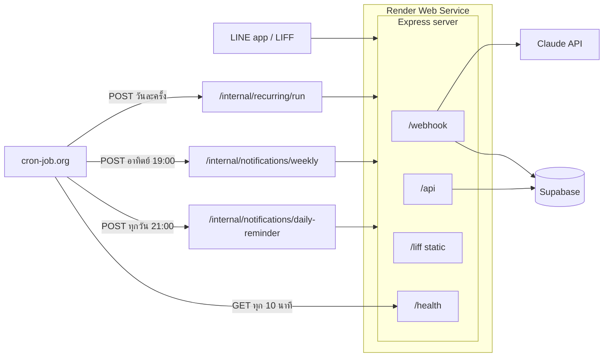

# line-expense-bot

LINE Official Account บันทึกรายรับรายจ่ายจากข้อความภาษาธรรมชาติ (เช่น "กินข้าว 60 กาแฟ 45") ใช้ Claude แยกข้อความ เก็บใน Supabase และมีเว็บ LIFF ในแอป LINE สำหรับดู แก้ และวิเคราะห์ รองรับหลายผู้ใช้

กติกาของเอกสารนี้: รายการละไม่เกิน 2 บรรทัด รายละเอียดพฤติกรรมอยู่ใน `SPEC.md` ขั้นตอนเต็มอยู่ในแผน `docs/superpowers/plans/` (เสร็จแล้วอยู่ใน `archive/`)

## ความสามารถ

- **บันทึกด้วยข้อความ:** กำกวมบอทถามกลับก่อนบันทึก ตอบเป็นการ์ด Flex พร้อมปุ่ม ยกเลิก แตะรายการในการ์ดเพื่อเปิดตัวแก้ไขในเว็บ
- **อ่านสลิป/ใบเสร็จ:** ส่งรูปแล้วบอทอ่านยอดสุทธิเป็นรายการเดียว ให้กดยืนยันก่อนบันทึก (รายจ่ายลงหมวด ใบเสร็จ/สลิปโอนเงิน)
- **สรุป:** `สรุปวันนี้` `สรุปสัปดาห์นี้` `สรุปเดือนนี้` (หรือ `สรุป` เพื่อเลือกช่วง) ยอดคิดด้วย SQL ส่งเป็นการ์ด
- **ถามยอด:** เช่น `เดือนนี้กินกาแฟไปเท่าไหร่` ตอบเป็นการ์ดพร้อมปุ่ม ดูรายการในเว็บ ที่เปิดหน้ารายการพร้อมตัวกรองตรงกับการ์ด
- **กระเป๋าเงิน:** ทุกคนมี `เงินสด` เพิ่ม/เปลี่ยนชื่อ/ซ่อนกระเป๋าอื่นในแท็บ ฉัน Claude เลือกกระเป๋าจากข้อความ เช่น `กาแฟ 60 บัตรเครดิต`
- **งบประมาณ:** ตั้งงบต่อหมวดต่อเดือน เตือนบนการ์ดเมื่อถึง 80% และเมื่อเกินงบ
- **รายการประจำ:** บันทึกอัตโนมัติตามรอบเดือน แจ้งใน LINE พร้อมปุ่มยกเลิก
- **สรุปรายสัปดาห์ / เตือนลืมจด:** สวิตช์ในแท็บ ฉัน (ค่าตั้งต้นปิด) ส่งทุกอาทิตย์ 19:00 / ทุกวัน 21:00 ถ้าวันนั้นยังไม่ได้จด
- **เป้าหมายการออม:** สร้างเป้าในแท็บ ออม ออมจากเว็บหรือพิมพ์ `ออม เที่ยวญี่ปุ่น 1000` (ใช้ได้เมื่อมีเป้าที่เปิดอยู่) ยอดออมไม่กระทบยอดคงเหลือ
- **หมวดของฉัน:** เพิ่ม เปลี่ยนชื่อ เลือกไอคอน ซ่อน และลบหมวด (รายการของหมวดที่ลบย้ายไป อื่นๆ) เปิดจากปุ่มล่างสุดของแท็บงบ
- **หารบิล:** หน้าแยกจากเว็บหลัก (`?tab=bills`) หารกับเพื่อน เพื่อนกดยืนยันจากการ์ดหรือในเว็บ อ่านยอดจากรูปใบเสร็จได้
- **เว็บ LIFF 5 แท็บ:** รายการ / สรุป (กราฟ แนวโน้ม 6 เดือน Export CSV) / งบ / ออม / ฉัน (การ์ดโปรไฟล์ และเมนูเข้ากระเป๋า หมวดหมู่ รายการประจำ การแจ้งเตือน เพื่อน วิธีใช้)
- **Rich Menu** (สร้างเองใน LINE OA Manager ไม่อยู่ใน repo): หารบิล / เสนอแนะ / วิธีการใช้ / เว็บไซต์ / สรุป

## สถาปัตยกรรม



| เส้นทาง | หน้าที่ |
| --- | --- |
| `POST /webhook` | รับ event จาก LINE (ตรวจ signature) |
| `/api/*` | API ของหน้า LIFF (ตรวจ ID token) |
| `/liff/` | ไฟล์ static ของหน้าเว็บ |
| `/exports/<token>` | ดาวน์โหลด CSV แบบลิงก์ใช้ครั้งเดียว |
| `POST /internal/*` | งาน cron 3 งาน ต้องมี `Authorization: Bearer <CRON_SECRET>` |
| `GET /health` | ตรวจสถานะ ใช้พิงกันเซิร์ฟเวอร์หลับ |

## Tech stack

- Node.js 24, Express 5, LINE Messaging API + LIFF (`@line/bot-sdk`), Claude API (`@anthropic-ai/sdk`), `sharp` ปรับรูปสลิป
- Supabase (Postgres) ผ่าน `@supabase/supabase-js`, เว็บ LIFF เป็น HTML + ES module ไม่มี build step
- vitest + jsdom, PGlite (Postgres ใน Node) สำหรับเทสต์ SQL, ESLint, GitHub Actions; Deploy: Render (Free) + cron-job.org

## โครงสร้างโฟลเดอร์

```
src/                        โค้ดฝั่ง server: bot.js, api, parser, query, slip, summary, budget, recurring,
                            notifications, goals, wallets, friends, bills, export, menu, db, utils
public/liff/                หน้าเว็บ LIFF และเทสต์ของหน้า
supabase/                   SQL schema และ migration (รันตามลำดับ หัวไฟล์บอกว่าต้องรันก่อน push ไหม)
scripts/                    สคริปต์ช่วยพัฒนา (try-parse)
docs/superpowers/plans/     แผนงานรายขั้น (ที่เสร็จแล้วอยู่ใน archive/ ซึ่ง .ignore ให้การค้นหาข้ามไว้)
work-memory/STATE.md        สถานะงานและสิ่งที่ค้าง (อ่านทุก session)
work-memory/LEARNED.md      สิ่งที่เรียนรู้ แยกตามหัวข้อ (อ่านเฉพาะที่เกี่ยว)
.ignore                     ให้ ripgrep ข้ามโฟลเดอร์ archive
render.yaml                 ตั้งค่า Render (Blueprint)
```

## รันในเครื่อง

1. `npm ci`
2. สร้าง `.env` (ห้าม commit) ดูชื่อตัวแปรใน `.env.example`:

   | ตัวแปร | คำอธิบาย |
   | --- | --- |
   | `LINE_CHANNEL_SECRET` / `LINE_CHANNEL_ACCESS_TOKEN` | ของ Messaging API ใช้ตรวจ signature / ตอบกลับและ push |
   | `ANTHROPIC_API_KEY` / `CLAUDE_MODEL` | API key ของ Claude / ชื่อโมเดล (ไม่บังคับ) |
   | `SUPABASE_URL` | `https://<ref>.supabase.co` เท่านั้น ห้ามมี `/rest/v1/` ต่อท้าย |
   | `SUPABASE_SERVICE_ROLE_KEY` | service role key (ฝั่ง server เท่านั้น) |
   | `LIFF_ID` / `LINE_LOGIN_CHANNEL_ID` | LIFF ID ของหน้าเว็บ / channel ID ของ LINE Login ใช้ verify ID token |
   | `CRON_SECRET` | secret ของ endpoint cron ยาวอย่างน้อย 32 ตัวอักษร |
   | `PORT` | ไม่บังคับ ค่าเริ่มต้น 3000 |

3. รัน SQL ใน Supabase SQL Editor ตามลำดับ: `schema.sql` แล้ว `002` ถึง `025` (ไม่มี 016)
   - ห้ามรัน `020` ซ้ำหลัง `024` (จะได้ `query_totals` สองแบบ โค้ดเก่าเรียกแล้วล้ม) ถ้าเผลอรันให้รัน `024` ซ้ำ
4. `npm start` (ทดสอบกับ LINE จริงจากเครื่องต้องใช้ tunnel เช่น ngrok ซึ่งทำให้บอทที่ deploy หยุดตอบระหว่างนั้น)

## Deploy (Render)

ขั้นตอนเต็มอยู่ที่ `docs/superpowers/plans/archive/2026-10-02-deploy-render.md`

1. push เข้า `main` = deploy อัตโนมัติ (บอทอาจไม่ตอบ 2-5 นาที) ถ้ามีไฟล์ SQL ใหม่ให้รันตามที่หัวไฟล์บอก ส่วนใหญ่ต้องรันก่อน push
2. สร้าง Blueprint จาก repo แล้วกรอก secret 8 ตัว (ตัวแปรในตารางข้างบน ยกเว้น `CLAUDE_MODEL` และ `PORT`)
3. Webhook URL = `<URL>/webhook`, LIFF Endpoint URL = `<URL>/liff/`
4. cron-job.org 4 งาน (เขตเวลา `Asia/Bangkok`, header `Authorization: Bearer <CRON_SECRET>` B ตัวใหญ่ และเปิดแจ้งเตือนเมื่อล้มเหลว):
   - `GET /health` ทุก 10 นาที, `POST /internal/recurring/run` วันละครั้ง
   - `POST /internal/notifications/weekly` อาทิตย์ 19:00 (Custom), `POST /internal/notifications/daily-reminder` ทุกวัน 21:00
5. LINE Login channel แท็บ LIFF: เปิด shareTargetPicker (ปุ่มส่งลิงก์ชวนเพื่อน), Scopes เปิด `openid` และ `profile`, Add friend option = On (aggressive)
6. LINE Login channel แท็บ Basic settings: Linked LINE Official Account = บอทนี้ (ต้องอยู่ provider เดียวกัน)

## คำสั่งพัฒนา

- `npm test` เทสต์ทั้งหมด รวม SQL function บน PGlite (ไม่ต้องต่อ Supabase)
- `npm run lint`, `npm run try-parse -- "<ข้อความ>"` ลองแยกข้อความกับ Claude จริง
- CI รัน lint, เทสต์ และ `node --check` ของ `index.js` กับ `public/liff/app.mjs` เมื่อ push เข้า `main` หรือเปิด PR

## ความปลอดภัย

- ตรวจ LINE signature ทุก webhook, หน้า LIFF ส่ง ID token ให้ server verify กับ LINE ทุกครั้ง
- RLS เปิดทุกตาราง function ใน DB ให้ `service_role` เท่านั้น secret อยู่ใน `.env` หรือ environment ของ Render
- rate limit: ข้อความ/รูปที่เรียก Claude 10/นาที, export 5/นาที, ค้นหา/เพิ่มเพื่อน 10/นาที, เปลี่ยนรหัสเพื่อน 10/ชม., สร้างบิล 10/ชม., อ่านใบเสร็จในฟอร์มบิล 20/ชม. (ต่อผู้ใช้)
- endpoint cron ป้องกันด้วย `CRON_SECRET` และตั้งใจไม่มี rate limit

## ข้อจำกัดที่ทราบ

- push (รายการประจำ, สรุปรายสัปดาห์, เตือนลืมจด, การ์ดบิล) นับโควตาข้อความต่อเดือนของ LINE OA ก้อนเดียวกัน ถ้าหมด LINE ตอบ 429
- งาน cron แจ้งเตือนส่งทีละคน อาจเกิน timeout 30 วินาทีของ cron-job.org เมื่อคนเปิดสวิตช์เยอะ push ที่พังไม่ลองซ้ำ (ดู `pushFailed`)
- Render Free หลับเมื่อไม่มี traffic 15 นาที (พิง `/health` กันไว้) และ Supabase Free อาจ pause โปรเจกต์ถ้าไม่ใช้หลายวัน
- ถ้า LINE ปฏิเสธการ์ด Flex หรือประมวลผลเกิน 50 วินาที ผู้ใช้อาจไม่ได้คำตอบจริงทั้งที่รายการบันทึกแล้ว ให้ตรวจในเว็บก่อนส่งซ้ำ
- หน้าหารบิลแสดงไม่เกิน 50 บิลล่าสุดต่อส่วน, เพื่อนที่ยังไม่เพิ่มบอทไม่ได้การ์ดบิล ต้องยืนยันในเว็บ
- ข้อเสนอแนะเก็บใน Google Form ภายนอก (ไม่รู้ว่าใครส่ง), CSV ยังไม่มีคอลัมน์กระเป๋า
- เทสต์ SQL รันบน PGlite: เรียงข้อความแบบ C collation (ชื่อไทยที่ขึ้นต้นด้วยสระหน้าเรียงต่างจาก Supabase)
